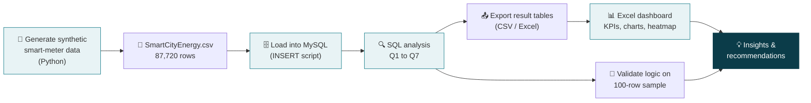

<div align="center">

# ⚡ WattWatch: Analyzing Urban Energy Consumption for Smarter Cities

**An end-to-end data analytics case study: MySQL → Excel Dashboard → Actionable Insights**


</div>

---

## 📑 Table of Contents
1. [Project Overview](#-project-overview)
2. [Business Questions & Objectives](#-business-questions--objectives)
3. [Tech Stack](#-tech-stack)
4. [Project Workflow](#-project-workflow)
5. [Dataset](#-dataset)
6. [Repository Structure](#-repository-structure)
7. [How to Run](#-how-to-run)
8. [Part 1: SQL Analysis (with MySQL Output)](#-part-1-sql-analysis)
9. [Part 2: Excel Dashboard](#-part-2-excel-dashboard)
10. [Key Insights](#-key-insights)
11. [Recommendations](#-recommendations)
12. [Skills Demonstrated](#-skills-demonstrated)
13. [Notes & Limitations](#-notes--limitations)
14. [About the Author](#-about-the-author)

---

## 🌆 Project Overview

A municipal data team needs to understand **how electricity is used across the zones of a smart city**, where energy is being **wasted**, and which **data-driven strategies** can make the city more sustainable.

This project takes smart-meter readings (consumption, peak load, outages, meter health and tariffs) and turns them into answers:

- 🏙️ Which zones are energy hotspots or inefficient?
- 🏭 Which consumer type uses the most power?
- 📅 Do certain days or seasons drive peak usage?
- 🔌 Where is the power supply unreliable, and which meters need to be replaced?

> **Deliverables:** SQL analysis script · Excel dashboard · written findings with recommendations.

---

## 🎯 Business Questions & Objectives

| # | Business question | Output |
|---|---|---|
| Q1 | How much energy does each zone use, in total and per day? | Zone consumption table |
| Q2 | Who are the top 5 energy consumers in each consumer type? | Ranked meter list |
| Q3 | How does consumption trend month by month across zones? | Monthly trend table |
| Q4 | What is the average cost per zone (kWh × tariff)? | Cost table |
| Q5 | Which meters have the most faults or outages? | Meter watchlist |
| Q6 | Which zones are least efficient (high usage + frequent outages)? | Efficiency score and rank |
| Q7 | Do peaks differ on weekdays vs weekends? | Peak-pattern tables |

---

## 🛠️ Tech Stack

| Layer | Tool |
|---|---|
| 🗄️ Database & analysis | **MySQL 8.0** (window functions, subqueries, conditional aggregation) |
| 📊 Visualization | **Microsoft Excel** (formulas, charts, conditional formatting, data-validation slicers) |
| 🐍 Data generation | **Python** (pandas, NumPy) to build the synthetic smart-meter dataset |
| 📝 Documentation | Markdown, Mermaid |

---

## 🔄 Project Workflow



---

## 🧾 Dataset

`SmartCityEnergy.csv` is **synthetic (AI-generated)**: 120 smart meters across 5 zones, one reading per meter per day from **1 Jan 2023 to 31 Dec 2024** (**87,720 rows**). Realistic patterns were built in (summer peaks, industrial-heavy East zone, outage-prone South zone, faulty meters) so the analysis has real signal to find.

| Column | Description |
|---|---|
| `MeterID` | Unique identifier for each smart meter |
| `Zone` | City zone (North, South, East, West, Central) |
| `ConsumerType` | Residential / Commercial / Industrial |
| `Date` | Reading date |
| `EnergyConsumed_kWh` | Total kilowatt-hours consumed |
| `PeakUsage_kWh` | Max kWh drawn in a single hour |
| `OutageMinutes` | Power outage duration in minutes |
| `MeterStatus` | Active / Faulty |
| `TariffRate` | Price per kWh at the time of billing |

---

## 📁 Repository Structure

```
WattWatch/
├── README.md
├── sql/
│   ├── SmartCity_SQL.sql              # Full analysis script (setup + Q1-Q7 + dashboard queries)
│   ├── SmartCityEnergy_Data.sql       # Loads the full 87,720-row dataset via INSERT statements
│   └── SmartCityEnergy_100.sql        # 100-row sample load + queries (used for the screenshots below)
├── data/
│   ├── SmartCityEnergy.csv            # Full synthetic dataset
│   └── SmartCityEnergy_100.csv        # 100-row sample
├── dashboard/
│   └── WattWatchDashboard.xlsx        # Interactive Excel dashboard
├── docs/
│   └── EnergyFindings.txt             # 7 actionable insights
└── images/                            # Screenshots used in this README
```

---

## 🚀 How to Run

1. **Load the data** into MySQL (no CSV import needed):
   ```sql
   SOURCE sql/SmartCityEnergy_100.sql;   -- quick 100-row sample (includes the queries)
   -- or
   SOURCE sql/SmartCityEnergy_Data.sql;  -- full 87,720-row dataset
   ```
2. **Run the analysis** in `sql/SmartCity_SQL.sql`, starting from the *PART 1* section (the setup block above it is only needed if you load via `LOAD DATA`).
3. **Open** `dashboard/WattWatchDashboard.xlsx`. Use the yellow dropdown cells (Zone, Type, From, To) to filter every KPI and chart.

> 💡 If `LOAD DATA LOCAL INFILE` is blocked on your server (`local_infile` / `secure_file_priv`), use the INSERT-script route above.

---

## 🔍 Part 1: SQL Analysis

Every query below was executed in the **MySQL command-line client**; the screenshots are real output from a **100-row validation sample** (20 meters × 5 dates).

| # | Technique highlights |
|---|---|
| Q1 | Subquery + aggregation (daily zone totals, then averages) |
| Q2 | `ROW_NUMBER() OVER (PARTITION BY …)` for top-N per group |
| Q3 | `DATE_FORMAT` grouping for monthly time series |
| Q4 | Aggregating computed expressions (`kWh × tariff`) |
| Q5 | Conditional aggregation with `SUM(condition)` |
| Q6 | `CROSS JOIN` against city averages, index scoring, `RANK()` |
| Q7 | `CASE`, `DAYOFWEEK`, `DAYNAME` for weekday/weekend profiling |

### 🧱 Step 0: Database & table setup, data load
Creates the `wattwatch` database, the typed `SmartCityEnergy` table and loads the rows.


### ✅ Data validation + Q1 (zone consumption) + Q2 (top 5 consumers by type)
Row count, meter count and date range are checked first. Then total/average daily energy per zone and the top 5 meters in each consumer type.


### 📈 Q3 (monthly trend) + Q4 (average cost per zone)
Monthly consumption by zone and cost per zone (`EnergyConsumed_kWh × TariffRate`).


### 🔧 Q5: Meters with the most faults / outages
Ranks meters by days with a fault or an outage, with cumulative outage minutes as the tiebreaker.


### ♻️ Q6 (zone efficiency) + Q7a (weekday vs weekend peaks)
Inefficiency score = average of the *usage index* and the *outage index* (city average = 1.0). Weekday and weekend peaks are compared by consumer type.


### 🗓️ Q7b (peak by day of week) + dashboard KPI queries
Peak by day of week, plus the KPI-card totals and the consumer-type split that feed the dashboard.


### 🧊 Dashboard data cube (Zone × Consumer Type × Month)
A compact aggregate that powers every dashboard filter, so the workbook stays fast without loading 87K raw rows.


---

## 📊 Part 2: Excel Dashboard

Built from the SQL results, using the **full 87,720-row dataset**.


| Component | Implementation |
|---|---|
| 🗺️ **Zone heatmap** | Tile map of the city layout, colour-scaled by kWh |
| 📈 **Line chart** | Monthly kWh trend, reacts to filters |
| 📊 **Bar graph** | Energy usage by consumer type |
| 🔢 **KPI cards** | Total Consumption · Avg Peak Usage · Total Outage Minutes · Total Estimated Cost |
| 🎚️ **Slicers** | Zone, Consumer Type and Date Range via dropdown cells driving `SUMIFS` formulas |
| 🚦 **Meter health** | Conditional formatting and data bars on a top-10 faulty-meter watchlist |

All dashboard numbers are **live formulas** (zero formula errors), not pasted values.

---

## 💡 Key Insights

Findings from the **full dataset** (87,720 readings), detailed in [`docs/EnergyFindings.txt`](docs/EnergyFindings.txt):

| # | Insight | Evidence |
|---|---|---|
| 1 | 🏭 **East zone is the energy hotspot**, driven by industry | 6.11M kWh = **42.6%** of city consumption with only 22 of 120 meters |
| 2 | ⚙️ **Industrial users dominate demand** | Industrial **68.2%**, Commercial 25.4%, Residential 6.5% of kWh |
| 3 | 🔌 **South zone has the least reliable supply** | **45.4%** of all outage minutes from 20% of meters; outages 2.3× city average |
| 4 | 🛠️ **11 meters were faulty on all 731 days** | Faulty meters see ~4× more outage minutes (9.4 vs 2.3 per day) |
| 5 | ☀️ **Strong summer seasonality** | May–Jul consumption ~60% above Dec–Jan, in both years |
| 6 | 📅 **Weekday peaks are ~24% higher than weekends** | Commercial −38% at weekends; residential +12% at weekends |
| 7 | ♻️ **East and South are inefficient for different reasons** | East = high usage (score 1.56); South = outages (score 1.24) |

> On the 100-row sample, the same query logic produces consistent signals: Industrial ≈ **74.8%** of kWh, commercial weekday peaks ≈ **52% higher** than weekend (9.79 vs 6.43 kWh), and South has the lowest usage per meter-day (27.27 kWh).

---

## ✅ Recommendations

| Area | Action |
|---|---|
| 🏭 East zone | Energy audits for the largest industrial meters; time-of-use tariffs and demand-response incentives |
| 🔌 South zone | Inspect and reinforce feeders and transformers; prioritise grid-maintenance budget |
| 🛠️ Meters | Replace or recalibrate persistently faulty meters; alert when a meter is `Faulty` for more than 30 days |
| ☀️ Seasonality | Schedule maintenance for Nov–Feb; add capacity and run cooling-efficiency campaigns before April |
| 📅 Peak shaving | Weekday peak pricing for commercial/industrial users; weekend awareness campaigns for homes |

---

## 🧠 Skills Demonstrated

- **SQL:** window functions (`ROW_NUMBER`, `RANK`), subqueries, `CROSS JOIN`, conditional aggregation, date functions, query design for dashboards
- **Data modelling:** typed schema, indexes, pre-aggregated data cube
- **Data visualization:** KPI design, heatmaps, dynamic charts, conditional formatting in Excel
- **Analytical thinking:** defining an efficiency metric, separating *demand* problems from *reliability* problems
- **Data generation:** building realistic synthetic data with seasonality, weekday effects and failure patterns (Python)
- **Communication:** turning numbers into prioritised, actionable recommendations

---

## 📝 Notes & Limitations

- The dataset is **synthetic**, so patterns reflect the simulated data rather than a real city.
- The **MySQL screenshots use a 100-row sample** to validate query logic quickly; the **dashboard and headline insights use the full dataset**. Sample values (for example, which zone has the highest total kWh) differ from the full data because only 20 meters and 5 dates are included.
- Excel cannot create native slicers from code, so filters are dropdown cells; the zone heatmap is a tile map because the data has no coordinates. In Power BI these would become native slicers and a filled map.
- Costs use the dataset's tariff currency (no currency symbol).

---

## 👤 About the Author

**[Your Name]** · Data Analyst
🔗 [LinkedIn](https://www.linkedin.com/in/your-profile) · 💻 [GitHub](https://github.com/your-username) · ✉️ your.email@example.com

⭐ *If you found this project useful, consider giving the repo a star.*
